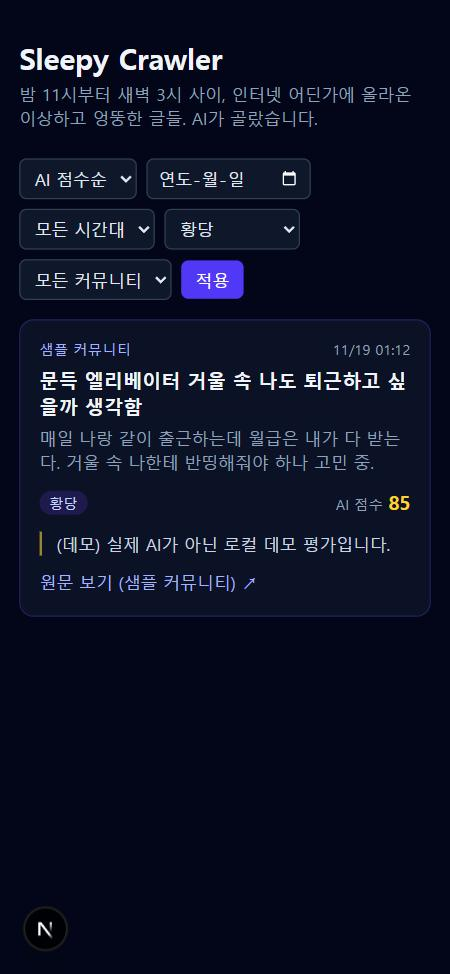

# Phase 1 보고서 — 기초 공사 + 기본 흐름

- 기간: 2026-11-18
- 브랜치: `feat/core-flow`
- 계획: `docs/superpowers/plans/2026-11-18-core-flow.md`
- 설계: `docs/superpowers/specs/2026-11-18-sleepy-crawler-design.md`

## 결과 요약

샘플(fixture) 소스로 **수집 → 중복 제거 → AI 평가 → 공개 여부 결정 → 웹사이트 노출** 흐름이 실제 PostgreSQL 위에서 끝까지 동작한다. AI 평가는 아직 가짜 평가기(`LLM_PROVIDER=fake`)로만 확인했다.

## 구현한 것

| 영역 | 파일 | 내용 |
|---|---|---|
| 시간 판정 | `src/core/time-window.ts` | 소스 시간대 기준 23:00:00 ≤ t < 03:00:00, 새벽 날짜·시간대 계산 |
| DB | `src/db/*` | 9개 테이블, 마이그레이션, 멱등 시드(키워드 15개, 프롬프트 v1, 설정, fixture 소스) |
| 정규화·중복 | `src/core/normalize.ts`, `dedupe.ts` | 정규 URL, 미리보기(120자), SimHash 유사 그룹 |
| AI 평가 규칙 | `src/core/evaluation/*` | JSON 스키마 검증, 배점 초과 거부, 100점 환산, 공개 결정 8단계 규칙 |
| 외부 요청 | `src/lib/http.ts` | robots.txt 확인(24시간 캐시), 호스트별 간격, 타임아웃, 5xx 재시도, 429/403 즉시 중단 |
| 소스 | `src/sources/*` | 어댑터 인터페이스, fixture 소스(운영 환경에서 비활성) |
| 수집 | `src/pipeline/crawl.ts` | 시간 필터, 중복 저장 방지, 경로 기록, 실패 기록 후 계속 |
| 평가 | `src/pipeline/evaluate.ts`, `src/llm/*` | 본문 임시 조회(저장 안 함), LLM 1회 재시도, 실패 시 비공개, 관리자 결정 보존 |
| 워커 | `src/worker/*` | pg-boss 큐(tick/crawl/evaluate), 1분 스케줄러, 일일 평가 상한, 수동 CLI |
| 공개 피드 | `src/feed/query.ts`, `src/app/(public)/*` | 최신/점수순, 날짜·시간대·유형·커뮤니티 필터, 유사 그룹 1건만, 커서 페이지 |

## 테스트 결과

- `npm test`: **97개 통과** (테스트 파일 17개). 3회 연속 통과 확인.
- `npx tsc --noEmit`: 오류 없음.
- `npm run build`: 성공. `/`는 Partial Prerender(정적 껍데기 + 요청 시 피드 스트리밍).

## 수동 확인

| 확인 | 명령 / 방법 | 결과 |
|---|---|---|
| 마이그레이션·시드 | `docker compose up -d && npm run db:migrate && npm run db:seed` | 성공 |
| 1회 수집+평가 | `LLM_PROVIDER=fake npm run crawl:once -- fixture --now 2026-11-18T19:00:00Z` | 14건 발견, 11건 저장, 시간대 밖 2건 제외, 중복 1건 |
| 워커 | `LLM_PROVIDER=fake npm run worker` | 1분마다 tick. 소스 시간대를 잠시 현재가 새벽인 곳으로 바꾸자 crawl → evaluate 작업이 큐로 실행됨 |
| 피드 | 개발 서버 `/`, `/?sort=score&category=ABSURD` | 카드 필수 항목 표시, 필터 동작, 375px 폭에서 가로 스크롤 없음, 제목의 `<script>`는 글자로만 표시 |

## 확인하지 못한 것 / 알려진 문제

- **실제 OpenAI 호출**: API 키가 없어 확인하지 않았다. 구조화 출력 스키마 변환(`src/llm/openai.ts`)은 실제 호출로 검증이 필요하다.
- **Windows에서 워커 종료**: `npx`를 거쳐 실행하면 Ctrl+C가 워커까지 전달되지 않아 정상 종료를 확인하지 못했다. Docker(리눅스)에서는 SIGTERM이 직접 전달된다.
- **`.env`의 `DATABASE_URL` 중복**: 사용자가 추가한 두 번째 줄(로컬 Postgres)을 Next.js가 사용하고, CLI 스크립트는 첫 줄(Docker DB)을 사용한다. 한쪽으로 정리가 필요하다.
- 테스트는 메모리 사용 때문에 워커 2개로 제한했다(약 30초).

## 남은 것 (후속 계획)

- 계획 2: 사이트별 수집 허용 조사(`docs/sources.md`), Reddit·한국 커뮤니티 어댑터, 80:20 배분, 03:00 이후 후속 수집, 서브레딧 관리
- 계획 3: 익명 제보(Turnstile, 요청 제한, SSRF 방지)
- 계획 4: 관리자(로그인, 대시보드, 커뮤니티·키워드·밈·프롬프트 관리, 재평가 비교, 게시글 관리)
- 계획 5: 배포(Dockerfile, VPS, Caddy), E2E 테스트, 운영 문서
